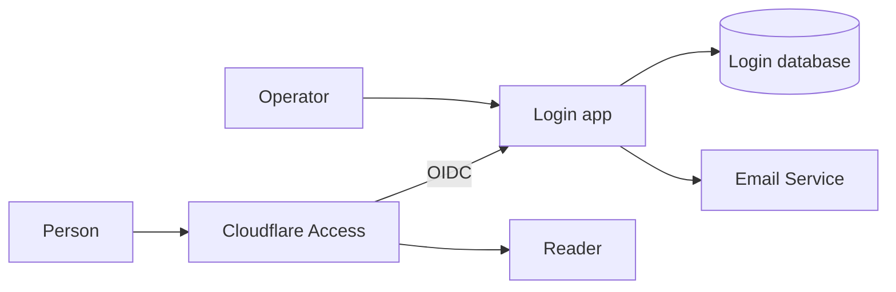
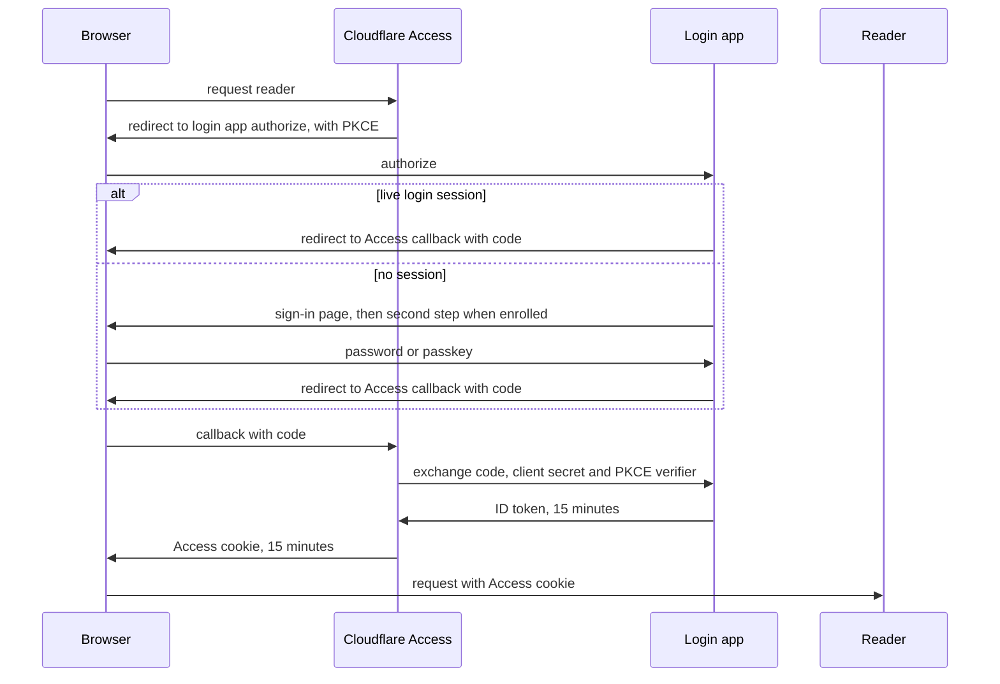

# RFC 001: Identity service for reader

| Field   | Value                                                                                                                                                                                                          |
| ------- | -------------------------------------------------------------------------------------------------------------------------------------------------------------------------------------------------------------- |
| Status  | Draft                                                                                                                                                                                                          |
| Author  | Matthijs van Henten                                                                                                                                                                                            |
| Date    | 2026-11-07                                                                                                                                                                                                     |
| Related | [#53](https://github.com/remit-mail/reader-cloudflare/issues/53), [#54](https://github.com/remit-mail/reader-cloudflare/issues/54), [remit-mail/reader#1519](https://github.com/remit-mail/reader/issues/1519) |

---

## Summary

Reader on Cloudflare signs people in through Cloudflare Access, with a one-time PIN sent by email. We want to invite family and friends. This RFC adds a small login app that Access trusts as its identity provider. People sign in with a password, and add a passkey or an authenticator app if they want one. The PIN goes away.

Self-host keeps its own sign-in. It gets a kill switch and a page to manage accounts.

## Problem statement

Access admits only the emails listed in the deployment config. Adding a person takes a config change and a deploy, and that person then signs in with a code from their inbox.

The people we want to invite won't sign in with Google or GitHub. Cloudflare has no managed identity provider for password and passkey sign-in.

Self-host has no way to stop every sign-in at once, and no page to see or manage accounts. The operator closes sign-up by editing the environment file by hand.

## Proposal

Each host uses its cloud's managed auth. On Cloudflare, Access remains the gate in front of reader and its single kill switch. Reader trusts the identity Access asserts.

The login app runs as its own Worker on its own domain. It keeps accounts in its own database and sends invites and codes through Cloudflare Email Service. It builds on the same open-source auth library as self-host.

An operator sends an invite. The person opens the link, confirms with a button and chooses a password. A second factor is optional. Once added, every password sign-in requires it. Email codes reset a password and nothing else.

Sessions feel long. The login session lasts weeks, and Access renews its own short session from it in the background. Signing out, a reset or an operator action ends the login session at once, and Access follows within 15 minutes.

Operators are named in the deployment config. A plain admin page in the login app lets them invite, disable, enable, reset factors and end every session of a person. Each action asks for a fresh passkey or authenticator check.

Agent credentials reach neither the login database, nor its secrets, nor its logs.

Self-host keeps its sign-in inside the reader server. It adds a kill switch, shell commands to recover an account, and a People page that checks the caller's password before each action.

## Business requirements

- **BR-1 Invite the people I choose.** As the operator, I want to invite people by email, so that only the people I chose reach reader.
- **BR-2 Sign in once and stay in.** As a user, I want to use a password or a passkey and stay signed in for weeks, so that reader feels like any other mail app.
- **BR-3 Cut someone off fast.** As the operator, I need to end one person's access, or everyone's, within minutes, so that a lost device or a departed user stops there.

## Functional requirements

- **FR-1 Invite.** An operator invites a person by email. The link lives 7 days and works once. Only pressing Continue redeems it. (BR-1)
- **FR-2 Onboard.** The invitee chooses a password of 12 to 128 characters that is in no known breach. They then add a second factor, or skip. (BR-1, BR-2)
- **FR-3 Sign in.** Sign-in takes a passkey, or a password plus the second factor when one is set up. (BR-2)
- **FR-4 Recover.** An email code resets a forgotten password and never skips the second factor. A backup code or an operator reset recovers a lost phone. (BR-2)
- **FR-5 Long sessions.** The login session rolls for 90 days. Access renews its 15-minute session from it without a prompt. (BR-2)
- **FR-6 Security page.** A person manages factors and password on the login site. Reader's settings link to it. (BR-2)
- **FR-7 Operator actions.** An operator invites, disables, enables, resets factors and signs a person out everywhere. Each action needs a fresh second-factor check, bound to that action and that person. (BR-1, BR-3)
- **FR-8 Self-host kill switch.** One command turns sign-in off on self-host and revokes every session. Turning it on again keeps all data. (BR-3)
- **FR-9 Self-host People page.** A signed-in user lists every account, and signs out, resets, disables or enables another. Each needs the caller's password. Shell commands enable and reset an account. (BR-1, BR-3)

## Non-functional requirements

- **NFR-1 Access is the boundary.** Every request to reader on Cloudflare passes Access. The operator stops everyone in Access. (BR-3)
- **NFR-2 Revocation within 15 minutes.** Every way a session ends reaches Access within 15 minutes, when its session fails to renew. (BR-3)
- **NFR-3 Agents stay out.** Agent credentials cannot read login data, secrets or logs. The agent service token is refused on the login domain. (BR-3)
- **NFR-4 Guessing is slow.** After 5 wrong tries, each try waits longer, per account and per IP. A reset request answers the same for every email. (BR-3)
- **NFR-5 Tokens.** Invite tokens, codes and reset links work once, expire, and are stored only as a hash. (BR-1, BR-3)
- **NFR-6 Audit.** Every sign-in event and operator action is recorded with time, actor, target, IP and outcome, for 90 days. A record holds no password, token or code. (BR-3)

## FAQ

**Why not build our own login?** Passwords, passkeys and OIDC come from a maintained library, the one self-host already runs. The login app is a thin layer over it, and Access still checks every request to reader.

**Why not sign in with Google?** The family and friends we invite won't use it for their mail. Access can add Google or GitHub as another identity provider later.

**Why can a revoked session last 15 minutes?** Access keeps its own session, and the login app holds no Cloudflare token to end it. A revoke reaches Access when that 15-minute session fails to renew.

**What does it cost?** Access is free for up to 50 users. The login app runs on the Workers Paid plan the account already has. That plan includes 3,000 sent emails a month.

**What happens at cutover?** The login app reaches dev first, then prod beside the PIN. The PIN goes once every current user has signed in through it. When a person's identity changes, we wipe their mail store and resync it.

**Can an agent invite someone?** Every admin action takes an operator's login session plus a second-factor check made for that action. Agents hold neither.

**Why has self-host no admin role?** Self-host trusts every account it holds. The People page opens only after self sign-up closes. Each action needs the caller's password, and the shell undoes any of them.

## Appendix: Security model

Every request to reader carries an Access session. The login app is an OpenID Connect identity provider that Access trusts. It signs ID tokens with an RS256 key that Access fetches from the login app's key endpoint.

Removing the login identity provider or its policy from the reader application stops every new Access session. No credential in this design revokes an Access session directly, so a session ends at Access when it expires after 15 minutes and renewal fails.

Its database, secrets and session cookie belong to the login app alone. Reader has no binding to the login database. The login domain has no Access application in front of it, because the login app is the identity provider. An infrastructure check fails the plan when any Access application names the login domain.

Operators are the addresses in the `operator_emails` field of the deployment config. The deployment config stays out of git. An operator signs in like everyone else and must hold a second factor before the admin page does anything. Each admin action runs a step-up:

1. The page asks the login app for a challenge for one action and one target.
2. A challenge is recorded, bound to the operator, the session, the action and its target. It lives 2 minutes.
3. An operator answers with a user-verified passkey assertion, or an authenticator code when they hold no passkey. Backup codes never unlock an admin action.
4. Consuming the challenge comes before checking the proof. A challenge works once, for its own action and target only. An authenticator time step works once.
5. A failed proof counts toward backoff and is audited.

To anyone who is not an operator, every admin path answers the same 404 as an unknown path. Disabling and resetting the factors of the operator's own account are refused.

The first operator is invited by a scheduled job. While no operator has an account, the job sends each operator email an ordinary 7-day invite. It stops once any operator has an account. Later operators are invited from the admin page.

Agents hold a read-biased debug token and the agent service token. This change drops D1 read and Workers tail from the debug token, because Cloudflare scopes both to the whole account and a tail event carries the request's cookies. Invocation logs are off on the login app, and it writes application logs from a field allowlist that holds no body, cookie, header, token or code. That service token works only through Access, and no Access application covers the login domain. On top of that, the login app refuses, with 403, any request that carries an Access service-token header, an Access JWT or an Access cookie.

The deploy creates the login app's auth secret with the runner token, outside the infrastructure state, and never reads it back. The OIDC client secret lives in the infrastructure state and the Secrets Store. It only lets a holder redeem an authorization code it has already intercepted, which PKCE also blocks.

Every state-changing request is a POST, and its `Origin` must equal the login origin. The one exception is the token endpoint, which Access calls server to server. Every response sets a strict content security policy, forbids framing, sets HSTS and sends no referrer.

## Appendix: Threat model

Assets, in order of value:

1. The signing keys. A forged ID token is any user to Access, and so every tenant.
2. The auth secret. It decrypts the signing keys, authenticator secrets and backup codes, and signs session cookies.
3. Operator accounts. An operator invites anyone and disables or resets any other account.
4. Credentials: password hashes, authenticator secrets, backup codes and passkey public keys.
5. Sessions: login sessions and Access sessions.
6. The OIDC client secret.
7. Invite tokens and email codes in transit.
8. Audit records, which hold emails and network addresses.

| Threat                                           | Mitigation                                                                                                                                                                               | Residual                                                   |
| ------------------------------------------------ | ---------------------------------------------------------------------------------------------------------------------------------------------------------------------------------------- | ---------------------------------------------------------- |
| Someone creates an account without an invite     | Open sign-up is off. The only path that creates a user sits behind a grant that only the invite POST issues                                                                              | None known                                                 |
| A mail scanner or link preview redeems an invite | The token sits in the URL fragment, which never reaches a server. Only the Continue POST redeems it                                                                                      | None                                                       |
| Password guessing                                | Backoff per account and per IP after 5 failures, up to 2 minutes per account and 15 minutes per IP. Passkey sign-in is exempt, so a stranger cannot lock a passkey user out              | One network can try slowly                                 |
| Account enumeration through reset                | The reset request answers before any lookup, with one body and the same timing for every email                                                                                           | None known                                                 |
| A reset by email code bypasses the second factor | A code sets a password only. The next sign-in still asks for the passkey or app                                                                                                          | None                                                       |
| A stolen Access cookie                           | It lives 15 minutes and cannot renew once the login session ends                                                                                                                         | Up to 15 minutes of access                                 |
| An authorization code redeemed after sign-out    | The token endpoint refuses a code whose login session is gone or whose user is disabled                                                                                                  | None known                                                 |
| Cross-site POST                                  | Exact `Origin` check, SameSite cookies, no framing                                                                                                                                       | None known                                                 |
| An open redirect at sign-in                      | One registered client with one exact redirect URI per stage. A mismatch shows an error and redirects nowhere                                                                             | None                                                       |
| An agent reaches identity data                   | No database or tail read, invocation logs off, Access headers refused on the login domain                                                                                                | The infrastructure state holds the OIDC client secret      |
| An operator's step-up is replayed                | A challenge is single-use, bound to action, target and session, and lives 2 minutes                                                                                                      | An authenticator-only operator is as strong as their phone |
| Someone takes the first operator's invite        | The bootstrap invite goes only to operator addresses, and stops once any operator has an account                                                                                         | The first person to read that inbox                        |
| Session tokens read from the database            | The cookie carries the token plus an HMAC with the auth secret, so a database read alone cannot present a session                                                                        | Tokens sit in plain text in the login database             |
| Dev and prod share one Zero Trust organization   | Every Access application lists its allowed identity providers. A check keeps each stage's login provider off the other stage. Each stage has its own database, cookie and passkey domain | The organization session is one setting for both           |

## Appendix: The OIDC flow

The login app registers one client per stage, seeded by the deploy, with the Access callback of that stage as its only redirect URI. Dynamic client registration is off. Consent is skipped for that client. The grant type is authorization code with PKCE, so no refresh token exists. An authorization code lives 60 seconds. ID and access tokens live 15 minutes. Scopes are `openid`, `email` and `profile`.

Access reads the email claim and asserts the subject the login app issues. Reader derives the tenant from that subject.

The signing keys rotate every 90 days and the old public key stays published for 2 days. An operator can rotate them from the admin page, with a step-up. On a suspected compromise the same action removes every old key and every session, so every device fails renewal within 15 minutes.

## Appendix: Session mechanics

| Session                                    | Life                                                                             |
| ------------------------------------------ | -------------------------------------------------------------------------------- |
| Login session                              | 90 days, rolling on each day of use                                              |
| Access application session                 | 15 minutes                                                                       |
| Access organization session                | 15 minutes. Access reissues an app session from it without the identity provider |
| Authorization code                         | 60 seconds                                                                       |
| ID and access token                        | 15 minutes, no refresh token                                                     |
| Reauthentication window for factor changes | 5 minutes                                                                        |
| Operator challenge                         | 2 minutes, one action                                                            |
| Invite                                     | 7 days, single use                                                               |
| Email code                                 | 10 minutes, single use, 5 tries                                                  |

When the Access session lapses, Access redirects to the login app. A live login session issues a code without a page, and the person lands back where they were. Reader probes its own session every 5 minutes while the tab is visible and when the tab becomes visible again. On a lapsed session it reloads the page once at the top level, which runs the renewal.

| Action                           | Ends                                                                            |
| -------------------------------- | ------------------------------------------------------------------------------- |
| Sign out                         | This device at once, through the Access logout                                  |
| Sign out everywhere, by the user | This device at once, others within 15 minutes                                   |
| Password reset                   | Every other device within 15 minutes                                            |
| Password change                  | Every other device within 15 minutes                                            |
| Operator: sign out everywhere    | Every device within 15 minutes                                                  |
| Operator: reset factors          | Removes the app, backup codes and passkeys, then every device within 15 minutes |
| Operator: disable                | Every device within 15 minutes, and sign-in says the account is disabled        |

An operator action runs in one database batch: disable the user, delete the sessions, then delete the issued tokens.

Adding or removing a factor, changing the password, regenerating backup codes and signing out everywhere each need the password or a passkey from the last 5 minutes. Each change sends the account a notice by email.

While prod allows both the PIN and the login app, Access shows its chooser at each renewal. Once the PIN is gone, Access sends a visitor straight to the login app.

## Appendix: Self-host

Self-host runs the auth library inside the reader server, with email and password sign-in. It has no owner or admin role. Any signed-in, enabled user takes operator actions once self sign-up is closed. Its API verifies RS256 JWTs that live 15 minutes, against the published keys, without a session lookup.

The kill switch is a setting in the server's environment file, changed by `remit sign-in on|off`. This command writes the setting once, restarts the stack, and probes the running server to prove it read the new value. It fails loudly when the probe disagrees. With sign-in off:

1. Every sign-in, sign-up, session read, token mint and password reset is refused with "Sign-in is turned off on this server."
2. Every session and every MCP grant is revoked at boot. API calls stop within 15 minutes, when the last JWT expires.
3. Calendar feeds answer the same 404 an unknown feed gets, and resume when sign-in is back on.
4. The People operations are refused.
5. The change is audited.

Turning it back on restores sign-in. Mail, accounts, settings and feeds stay intact. Sessions and grants revoked while it was off stay revoked. `remit sign-up on|off` closes and opens self sign-up the same way.

The People API lists every account with email, created date, last sign-in, session count and status. Every action on a person needs a step-up:

1. Callers send their own password, the action and the target person.
2. A failed try is recorded before the password check. At 5 failures in 15 minutes the step-up answers 429.
3. A correct password returns a token for that action and target. It lives 5 minutes and works once.
4. The action consumes the token in the same transaction as the change.

The actions are sign out everywhere, reset password, disable and enable. Disabling revokes sessions, MCP grants and calendar feeds. Nobody disables their own account. Each write re-checks that the caller is still enabled, so two users who disable each other leave one enabled. The People operations answer 404 while self sign-up is open, because anyone can then make themselves an operator.

A password reset replaces the password with a random one, revokes sessions and shows a reset link once. The link lives 24 hours, works once and is stored as a hash. Opening it uses nothing. Only the POST that sets the new password redeems it. Only a signed-in user with a step-up, or the host shell, issues a reset link.

From the host shell, `remit people enable <email>` re-enables an account and `remit people reset <email>` prints a reset link. Shell access to the host is the trust root, so these need no step-up. An insider who disabled everyone else is undone with these two commands.

Every action, kill switch change and refusal writes an audit record with time, actor, target, action, outcome and client IP. Records stay 90 days and never hold a password, token or link.

## Appendix: Terms

| Term              | Meaning                                                                      |
| ----------------- | ---------------------------------------------------------------------------- |
| Access            | Cloudflare Access, the gate in front of reader on Cloudflare                 |
| Identity provider | The service that signs a person in and tells Access who they are             |
| OIDC              | OpenID Connect, the protocol Access uses to ask an identity provider         |
| Login app         | The Worker on its own domain that is reader's identity provider              |
| Operator          | A person named in the deployment config who runs the admin page              |
| Step-up           | A fresh proof of identity for one sensitive action                           |
| Second factor     | A passkey, or an authenticator app with backup codes                         |
| Kill switch       | One control that stops every sign-in at once                                 |
| PKCE              | A one-time secret that binds an authorization code to the browser that asked |
